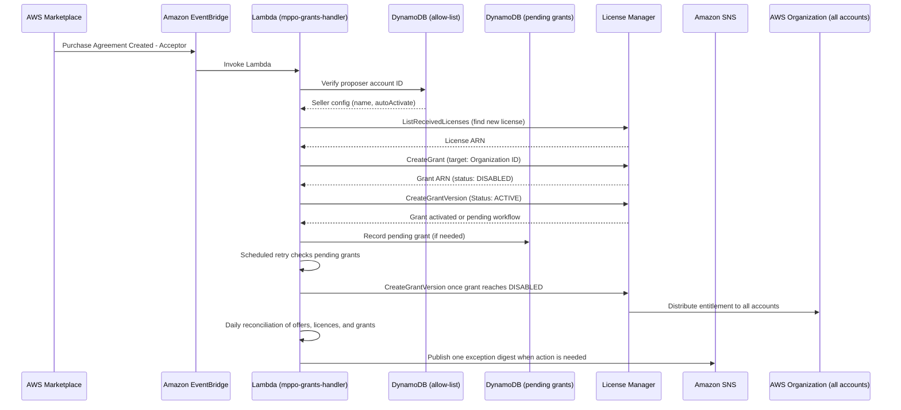

# Architecture

## Scope & Limitations

**This only applies to License Manager-backed product types.** [Managed entitlements for Amazon Bedrock](https://docs.aws.amazon.com/bedrock/latest/userguide/managed-entitlements.html) — and AWS Marketplace managed entitlements generally — works through AWS License Manager, which only issues licenses for **AMI, Container, Machine Learning, and AWS Data Exchange** product types. Bedrock third-party model subscriptions (this sample's use case) fall under Machine Learning.

**SaaS products are not covered by this automation, and can't be.** SaaS entitlements use a completely different mechanism: the seller's own backend checks access via the Marketplace `GetEntitlements` API, and AWS never creates a License Manager license for a SaaS subscription. There is no grant to create or activate — the Disabled→Active problem this repo solves doesn't exist for SaaS. Extending this automation to SaaS wouldn't mean widening the EventBridge rule or adding a handler branch; it would mean building an entirely different integration (polling `GetEntitlements`, reacting to the seller-facing `License Updated`/`License Deprovisioned` events). Out of scope for this sample.

**Practical implication for the allow-list:** `aws.agreement-marketplace` sends `Purchase Agreement Created - Acceptor` for *every* product type a buyer subscribes to, and this repo's seller allow-list (`config/sellers.json`) matches only on the seller's AWS account ID (`proposerAccountId`) — there's no per-product-type or per-ASIN scoping. If an allow-listed seller account sells both a License Manager-backed product (e.g. a Bedrock model) *and* a SaaS product, accepting the SaaS offer still triggers this Lambda, passes seller verification, then fails at license discovery (`discover_license.py`) because no License Manager license will ever exist for it. That failure is handled safely — `discover_license` fails closed and returns `None` rather than guessing — but it produces a false-positive `MPPO Grant FAILED - License Not Found` SNS alert for an agreement that was never supposed to get a grant. This is a real gap in the general pattern if you allow-list an ISV partner with a mixed product catalog.

## How It Works

### Architecture



### Grant Targeting

By default, grants target the **entire organization**. For granular control, add `grantTargets`:

| Target | Config | Use Case |
|--------|--------|----------|
| Organization (default) | Omit `grantTargets` | All current and future accounts |
| OU | `{"type": "ou", "id": "o-abc/ou-abc1-123"}` | Segmented rollout (e.g., prod OU first) |
| Account | `{"type": "account", "id": "111122223333"}` | Specific teams only |

```json
{
  "name": "Anthropic",
  "proposerAccountId": "123456789012",
  "grantTargets": [
    { "type": "ou", "id": "o-abc123/ou-abc1-12345678" },
    { "type": "account", "id": "999988887777" }
  ]
}
```

> **Note:** Account-level grants require the recipient to accept before activation (unlike org/OU grants which auto-accept).

### Grant Activation

Grants auto-accept but land in **Disabled** state. Until explicitly activated, accounts pay public list pricing.

This automation activates grants automatically via `CreateGrantVersion(Status=ACTIVE)`.

When creating the grant, the automation derives `AllowedOperations` from the parent License Manager grant when License Manager exposes that metadata. If the parent grant cannot be read, it falls back to the default Bedrock Marketplace operation set.

License Manager can take hours or days to move a newly created grant through workflow states before it becomes activatable. If the first Lambda invocation sees the grant still processing, it records the grant in `mppo-pending-grants`. A scheduled retry rule (`mppo-grant-activation-retry`, every 6 hours) keeps checking the grant and activates it once License Manager reports `DISABLED`.
